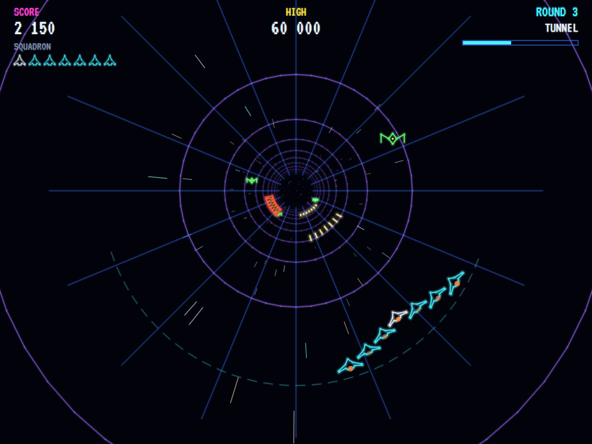
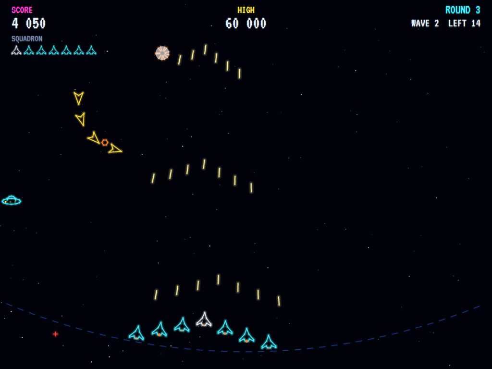
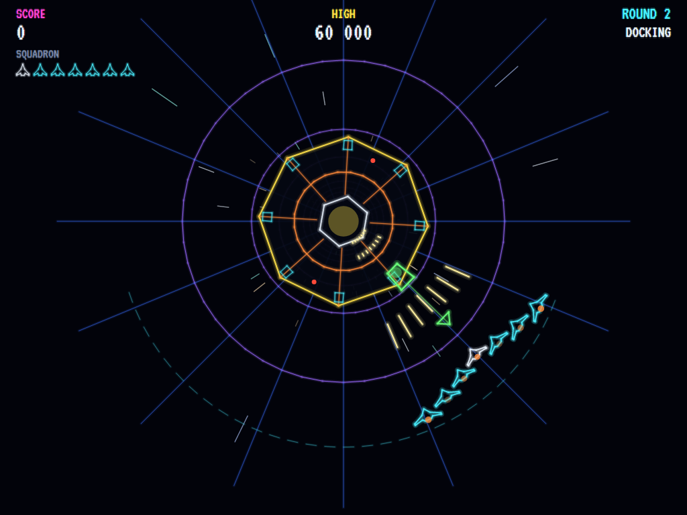
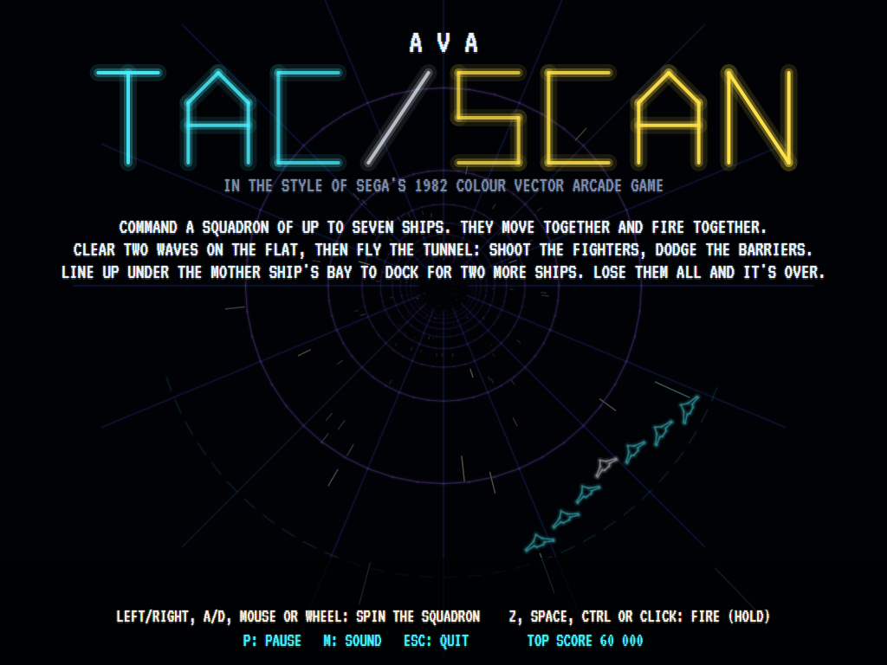

# AVA Tac/Scan

[](https://github.com/Harlock123/AVATacScan/actions/workflows/build.yml)

A colour vector shooter in the style of Sega's 1982 arcade game **Tac/Scan**, built with .NET 10 and Avalonia UI.
You don't fly one ship but a whole squadron of up to seven, in an arrowhead at the foot of the screen. They move
together, as one, along their track (the arcade machine had a spinner for it) and fire together, every ship at
once. A wide squadron puts a lot of shots in the air, but it's a big target, and every ship lost is gone from the
formation. Clear two waves on the flat, fly down the tunnel into the screen, then dock with the mother ship for
more ships.

## Features

- **A squadron, not a ship:** four ships to start, up to seven, flying in an arrowhead with the leader in front.
  Move it and they all move; fire and they all fire. When a ship is lost the ones behind slide up into the gap,
  and the squadron gets smaller and lighter on its feet: a narrower formation has more room to move.
- **The flat waves:** two a round. Saucers sway down the screen dropping shots, darts come in a string, swing
  round the top of the screen and dive at the squadron, spinning crosses bounce about the top and aim their fire
  (they take two hits), and from the second round bombers cross the screen and bomb whatever is under them. Shoot
  down the wave's quota to clear it; whatever slips past comes round again.
- **The tunnel:** after the second wave the squadron warps into a tube running into the screen, and flies round
  its near rim while everything comes out of the vanishing point: fighters (some spiralling, firing bolts down
  the tube), seekers that turn round the tube to follow the squadron, and barriers, bands of force across part
  of the tube that no shot can break. A barrier takes every ship under it, so fly the squadron round it; there's
  always room for a full squadron to get by.
- **The mother ship:** at the end of the tunnel it comes down the tube, its docking bay lit on its rim and a
  guide beam down to the track. Have the leader under the bay when it arrives and the squadron docks: two more
  ships and a bonus. Already seven strong, the spare ships are points instead.
- **Harder every round:** more enemies to shoot down, more at once, faster, firing more often, and a longer
  tunnel; more kinds of enemy as the rounds go by.
- **Extra ships** for points (20 000, then every 50 000), up to seven. The game ends when the last ship goes.
- **Drawn like a vector monitor:** every line glowing on black, with a halo round it, the name in stroke
  lettering, stars drifting on the flat and streaming out of the tube in the tunnel.
- **Keys, mouse or gamepad:** the mouse is the spinner (move it and the squadron flies to the pointer, or turn
  the wheel a notch at a time), and on a gamepad either stick pushed further turns it faster.
- **The attract mode** shows the computer pilot at work: it reads the fire and the dives coming at every ship of
  the squadron, slips the formation between them, lines its ships up under the enemies, flies round the barriers
  and lines up on the bay to dock.
- **Sound:** the volley's lasers, explosions, the warp's rising rush, the mother ship's hum and beacon, and
  short original fanfares, all synthesised by the build tools.

## Screenshots

| The tunnel | A flat wave |
|:----------:|:-----------:|
|  |  |
| Fighters out of the vanishing point, a barrier coming. | Darts swinging round, a saucer, a bomb falling. |

| The mother ship | The title |
|:---------------:|:---------:|
|  |  |
| Line the leader up under the bay to dock. | |

The screenshots are made by the tests, which play the game in a real (headless) window; see
[Tests](#tests).

## Download and run

Ready-to-run builds for Windows, macOS and Linux, on both Intel/AMD and ARM, are on the
[Releases page](https://github.com/Harlock123/AVATacScan/releases/tag/latest). **Latest build** is
rebuilt on every push to `main`. Each download is one self-contained executable: no .NET install is
needed.

| Platform | Archive |
|---|---|
| Windows | `AVATacScan-win-x64.zip`, `AVATacScan-win-x86.zip`, `AVATacScan-win-arm64.zip` |
| macOS | `AVATacScan-osx-arm64.tar.gz` (Apple silicon), `AVATacScan-osx-x64.tar.gz` (Intel) |
| Linux | `AVATacScan-linux-x64.tar.gz`, `AVATacScan-linux-arm64.tar.gz`, `AVATacScan-linux-arm.tar.gz` |

```bash
tar -xzf AVATacScan-linux-x64.tar.gz     # or linux-arm64, linux-arm, osx-arm64, osx-x64
./AVATacScan
```

On Windows, unzip and run `AVATacScan.exe`. On macOS, if Gatekeeper refuses to open it, run
`xattr -d com.apple.quarantine AVATacScan` once. Run with `--no-audio` for silence.

**Sound** comes through OpenAL Soft, built in for every platform. In a virtual machine the game
detects it and uses a larger audio buffer, so the sound doesn't break up.

**Gamepads** use SDL2, which is bundled for Windows, macOS and Intel/AMD Linux. ARM Linux builds need it
installed; without it the keyboard still works:

```bash
sudo apt install libsdl2-dev            # Debian / Ubuntu / Raspberry Pi OS
sudo pacman -S --needed sdl2-compat     # Arch / Omarchy
```

## Controls

| Action | Keyboard | Mouse | Gamepad |
|---|---|---|---|
| Start | Enter, 1, or fire | Click | Start or A |
| Move the squadron (the spinner) | Left/Right, A/D or keypad 4/6 | Move it, or turn the wheel | Either stick, D-pad or the shoulder buttons |
| Fire (hold for volley after volley) | Z, Space, Ctrl or Shift | Button | A or right trigger |
| Pause | P or Esc | | Start or Back |
| Sound on/off | M | | |
| Screenshot | Ctrl+S (to your Pictures folder) | | |

Moving the mouse sends the squadron's leader to the place on the track nearest the pointer; a key or the stick
takes over from it until the mouse moves again. On the high-score table, type your initials, or use up/down and
Space, then Enter.

## Tests

```bash
dotnet test AVATacScan.slnx
```

The game runs in fixed 60 Hz steps, so it plays the same at any frame rate. The tests check:

- **The squadron:** four ships to start, in an arrowhead with the leader in front; it all moves together and keeps
  its spacing; it can go to the ends of the track but no further, and a wider squadron has less room; steering
  takes the leader to a place on the track, no faster than a hard turn of the spinner.
- **The guns:** every ship fires at once and the shots fly up the screen; holding fire keeps the volleys coming,
  no faster than the guns reload; a shot destroys an enemy in its path for points and misses one off to the side;
  a spinner takes two hits.
- **Losing ships:** enemy fire takes the ship it hits and the squadron closes up; fire that misses does no harm;
  an enemy flying into a ship takes it and is destroyed too; losing the last ship ends the game.
- **Extra ships:** points bring them, never more than seven; a new ship slides up into its slot from behind.
- **The flat waves:** enemies come a few at a time up to the quota; later rounds bring more kinds, more of them
  and faster; darts swing round the top then dive at the squadron; saucers that slip past come round again;
  bombers bomb only what's under them; spinners aim at a ship; a round starts with its call and no enemies until
  the wave; clearing a wave brings the next, and the second leads into the tunnel.
- **The tunnel:** deeper is nearer the vanishing point and smaller; the track runs round the bottom of the tube,
  left to right; the flat track is a shallow arc at the foot of the screen; a point on the screen maps back to the
  place on the track drawn there (the mouse). Shots fly down the tube and hit what's lined up with them and pass by
  what isn't; a barrier soaks up shots, takes every ship under it and none beside it, and always leaves room for a
  full squadron; a fighter takes only the ship under it; seekers turn towards the squadron; fighters' bolts take a
  ship; the tunnel fills with fighters, seekers and barriers.
- **The mother ship:** it comes at the end of the tunnel; lined up under the bay the squadron docks for two ships
  and a bonus, out of line it gets nothing, and a full squadron gets points for the spare ships; the bay is always
  somewhere the squadron can reach; after docking the next round starts on the flat.
- **The game:** the title, the demonstration (played in silence) and the high scores take turns; fire or Enter
  starts; paused, nothing moves; a good score gets initials on a table kept for next time; the game gets harder
  round by round; every sound has its file.
- **The computer pilot** clears the first round and docks, gets a full squadron round a barrier, and keeps a
  squadron alive and scoring for three minutes from round 3.
- **The controls,** through the input handler: right flies the squadron right on the screen and left left, on the
  flat and in the tunnel; up and down do nothing; Z, Space, Ctrl and Shift fire; the mouse flies the squadron to
  the pointer and its button fires; the wheel turns it a notch at a time; a key takes over from the mouse until it
  moves again; a Shift let go as Caps Lock is let go.

`tests/AVATacScan.Tests/PilotProbe.cs` reports how the computer pilot gets on over whole games, for tuning
(`TACSCAN_PROBE=1`, or a round number to start there; `TACSCAN_SEEDS=1,2,3`).

The screenshot tests draw the real screen in a headless window. To refresh the README's pictures:

```bash
TACSCAN_SHOTS=$PWD/Images dotnet test tests/AVATacScan.Tests --filter ScreenshotTests
```

## Building

```bash
dotnet build AVATacScan.slnx
dotnet run --project src/AVATacScan
```

Needs the .NET 10 SDK. The sounds are made by `tools/make_sounds.py` (standard-library Python):
`python3 tools/make_sounds.py` rewrites `src/AVATacScan/Sounds`.

## Project structure

```
AVATacScan/
├── AVATacScan.slnx
├── src/AVATacScan/
│   ├── Engine/
│   │   ├── GameEngine.cs        # States, the round: its call, the waves, the warp, the tunnel, docking, game over
│   │   ├── Sim.cs               # The squadron and its volleys, the flat's enemies, the tunnel's threats, the mother ship
│   │   ├── Field.cs             # The measures, the two tracks, the tunnel's projection, the rounds' difficulty
│   │   ├── World.cs             # Everything in play
│   │   ├── Pilot.cs             # The computer player (the demonstration, and the tests)
│   │   ├── HighScoreTable.cs, InitialsEntry.cs
│   │   ├── InputHandler.cs, ControllerManager.cs  # Keys, the mouse as a spinner, and an SDL2 gamepad
│   │   └── SoundManager.cs      # Effects and jingles through OpenAL
│   ├── Audio/                   # The OpenAL engine (from the author's AVABand)
│   ├── Views/                   # The drawing: glowing vector beams, the tube, the squadron, the enemies
│   └── Sounds/                  # The synthesised effects and jingles
├── tests/AVATacScan.Tests/      # Gameplay, tunnel, input, engine, pilot and screenshot tests
├── tools/make_sounds.py
└── Images/                      # Screenshots
```

## About and licence

AVA Tac/Scan © 2026 Lonnie Watson, under the [MIT License](LICENSE).

*Tac/Scan* © 1982 Sega; the name belongs to its current owner. AVA Tac/Scan is an independent, unofficial game in
its style. Its ships, enemies, graphics, sounds, music and code are its own; nothing is taken from the original
game's program, graphics or sound. It is not affiliated with or endorsed by any rights holder.

The VT323 font is by Peter Hull, under the SIL Open Font License (`src/AVATacScan/Assets/Fonts/VT323-OFL.txt`).
Sound plays through [OpenAL Soft](https://openal-soft.org/) (LGPL), via Silk.NET; gamepads through SDL2.
